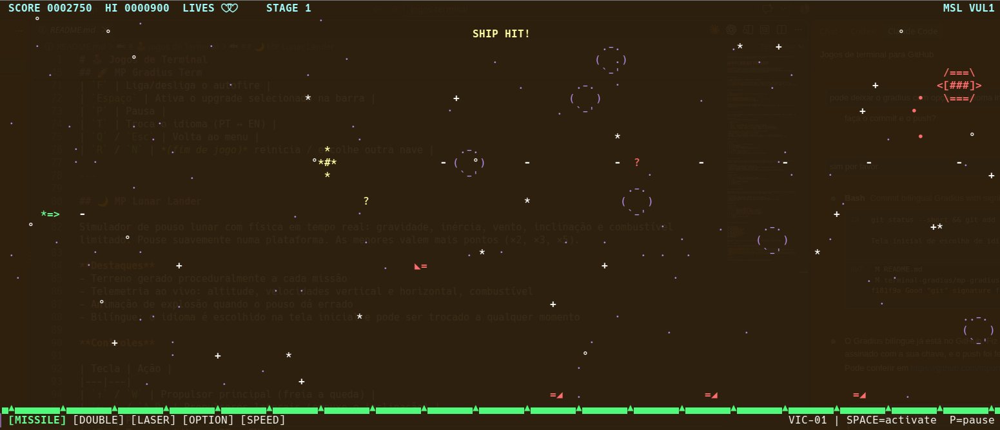
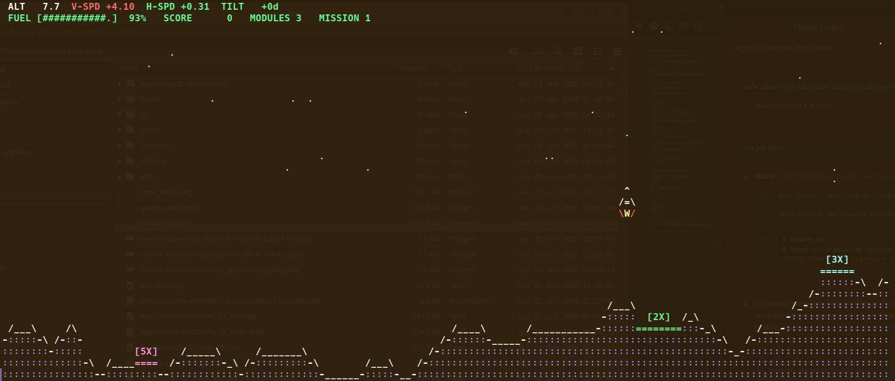
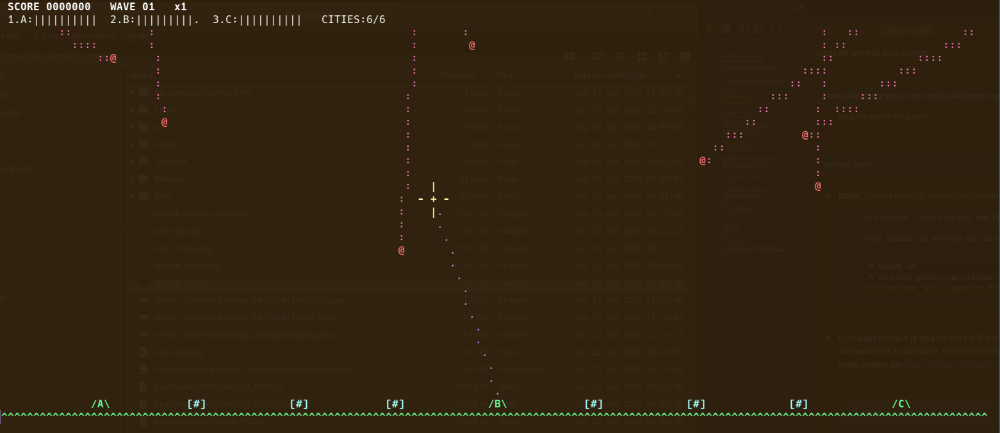
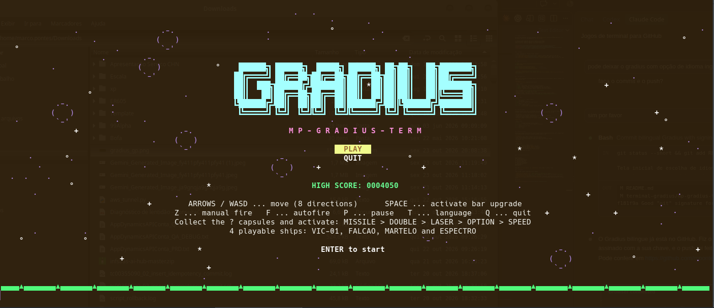
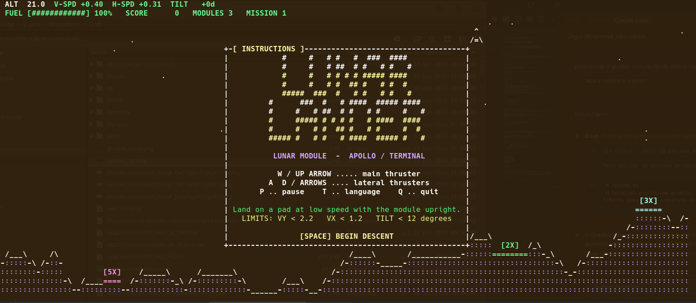
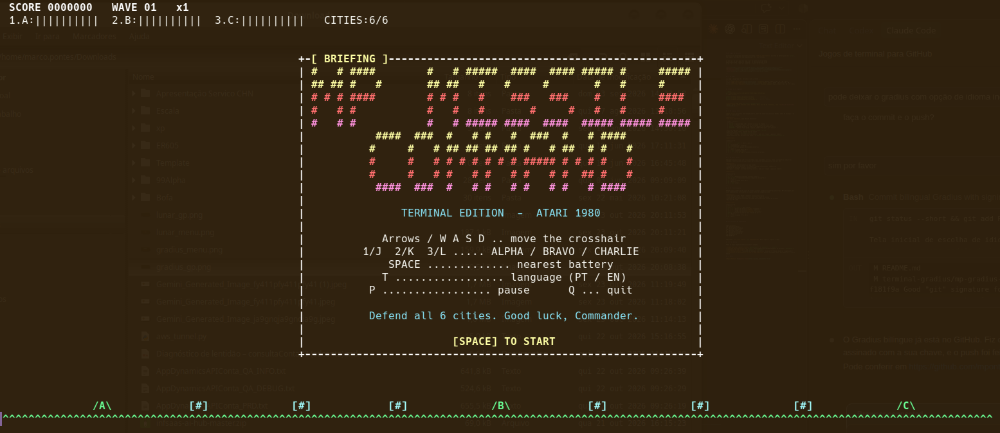

# 🕹️ Jogos de Terminal

Clássicos dos fliperamas e do Atari recriados **100% em modo texto**, escritos em Python puro com `curses`.
Sem engine, sem sprites, sem dependências: só o seu terminal.

```
░▀▀█░█▀█░█▀▀░█▀█░█▀▀░░░█▀▄░█▀▀░░░▀█▀░█▀▀░█▀▄░█▄█░▀█▀░█▀█░█▀█░█░░
░░░█░█░█░█░█░█░█░▀▀█░░░█░█░█▀▀░░░░█░░█▀▀░█▀▄░█░█░░█░░█░█░█▀█░█░░
░▀▀░░▀▀▀░▀▀▀░▀▀▀░▀▀▀░░░▀▀░░▀▀▀░░░░▀░░▀▀▀░▀░▀░▀░▀░▀▀▀░▀░▀░▀░▀░▀▀▀
```


<p align="center">
  
</p>

<table>
  <tr>
    <td width="50%"></td>
    <td width="50%"></td>
  </tr>
</table>

---

## 🎮 Os jogos

| | Jogo | Inspirado em | Terminal mínimo | Idioma |
|---|---|---|---|---|
| 🚀 | [**MP Gradius Term**](#-mp-gradius-term) | *Gradius* (Konami, 1985) | 80 × 24 | PT / EN |
| 🌙 | [**MP Lunar Lander**](#-mp-lunar-lander) | *Lunar Lander* (Atari, 1979) | 64 × 22 | PT / EN |
| 💥 | [**MP Míssil Comando**](#-mp-míssil-comando) | *Missile Command* (Atari, 1980) | 62 × 20 | PT / EN |

---

## ⚡ Jogar em 30 segundos

```bash
git clone https://github.com/mpontes-stack/jogos-terminal.git
cd jogos-terminal

python3 terminal-gradius/mp-gradius-term.py          # Gradius
python3 terminal-lunarlander/lunar_lander.py         # Lunar Lander
python3 terminal-misslecomando/missel_comando.py     # Míssil Comando
```

> **Windows?** Rode antes `pip install windows-curses`.
> Para o passo a passo completo (venv, Windows, WSL e solução de problemas), veja o **[Guia de Instalação](INSTALACAO.md)**.

---

## 🚀 MP Gradius Term

<table>
  <tr>
    <td></td>
    <td></td>
  </tr>
  <tr>
    <td align="center"><sub>Menu</sub></td>
    <td align="center"><sub>Gameplay</sub></td>
  </tr>
</table>

*Shoot 'em up* horizontal com rolagem lateral, barra de power-ups no estilo Konami, ondas de inimigos e um chefe no fim da fase.

**Destaques**
- **4 naves jogáveis**, cada uma com seu estilo:

  | Nave | Perfil |
  |---|---|
  | `VIC-01` | Equilibrada, com o arsenal clássico do Gradius |
  | `FALCAO` | Rápida e frágil: +25% de velocidade e cadência, só 2 vidas |
  | `MARTELO` | Blindada e lenta: já começa com MISSILE e tem explosão maior |
  | `ESPECTRO` | Options fixos acima e abaixo, LASER reforçado e tiro traseiro |

- Barra de upgrades `SPEED · MISSILE · DOUBLE · LASER · OPTION`
- Chefe com ponto fraco e segunda fase de ataque
- Recorde salvo em `~/.mp-gradius-term_hs.json`
- Bilíngue: o idioma é escolhido na tela inicial e pode ser trocado a qualquer momento
- Modo ASCII puro para terminais sem UTF-8: `MP_GRADIUS_ASCII=1 python3 mp-gradius-term.py`

**Controles**

| Tecla | Ação |
|---|---|
| `↑ ↓ ← →` / `W A S D` | Mover a nave |
| `Z` | Tiro manual |
| `F` | Liga/desliga o autofire |
| `Espaço` | Ativa o upgrade selecionado na barra |
| `P` | Pausa |
| `T` | Troca o idioma (PT ↔ EN) |
| `Q` / `Esc` | Volta ao menu |
| `R` / `N` | *(fim de jogo)* reinicia / escolhe outra nave |

---

## 🌙 MP Lunar Lander

<table>
  <tr>
    <td></td>
    <td></td>
  </tr>
  <tr>
    <td align="center"><sub>Menu</sub></td>
    <td align="center"><sub>Gameplay</sub></td>
  </tr>
</table>

Simulador de pouso lunar com física em tempo real: gravidade, inércia, vento, inclinação e combustível limitado. Pouse suavemente numa plataforma. As menores valem mais pontos (×2, ×3, ×5).

**Destaques**
- Terreno gerado proceduralmente a cada missão
- Telemetria ao vivo: altitude, velocidades vertical e horizontal, combustível
- Animação de explosão quando o pouso dá errado
- Bilíngue: o idioma é escolhido na tela inicial e pode ser trocado a qualquer momento

**Controles**

| Tecla | Ação |
|---|---|
| `↑` / `W` | Propulsor principal (freia a queda) |
| `← →` / `A D` | Propulsores laterais (empuxo e inclinação) |
| `P` | Pausa |
| `T` | Troca o idioma (PT ↔ EN) |
| `R` | Reinicia |
| `Q` / `Esc` | Sair |

---

## 💥 MP Míssil Comando

<table>
  <tr>
    <td></td>
    <td></td>
  </tr>
  <tr>
    <td align="center"><sub>Menu</sub></td>
    <td align="center"><sub>Gameplay</sub></td>
  </tr>
</table>

Defenda suas cidades de uma chuva de mísseis inimigos usando três baterias antiaéreas. Mire e dispare para criar explosões que interceptam os ataques antes que cheguem ao chão.

**Destaques**
- Três baterias (ALFA, BRAVO e CHARLIE) com munição própria
- Ondas progressivamente mais difíceis, com vários tipos de inimigo
- Colisão por distância euclidiana corrigida pelo formato das células do terminal
- Bilíngue PT / EN

**Controles**

| Tecla | Ação |
|---|---|
| `↑ ↓ ← →` / `W A S D` | Move a mira |
| `1` / `J` | Dispara da bateria **ALFA** (esquerda) |
| `2` / `K` | Dispara da bateria **BRAVO** (centro) |
| `3` / `L` | Dispara da bateria **CHARLIE** (direita) |
| `Espaço` | Dispara da bateria mais próxima da mira |
| `P` | Pausa |
| `T` | Troca o idioma (PT ↔ EN) |
| `Q` | Sair |

---

## 🗂️ Estrutura do repositório

```
jogos-terminal/
├── terminal-gradius/
│   └── mp-gradius-term.py
├── terminal-lunarlander/
│   └── lunar_lander.py
├── terminal-misslecomando/
│   └── missel_comando.py
├── screenshots/
├── INSTALACAO.md
└── README.md
```

Cada jogo é **um único arquivo `.py` independente**. Basta copiar o arquivo e rodar.

## 🛠️ Por dentro

Todos os jogos seguem a mesma arquitetura simples:

- **Game loop com framerate fixo**: `handle_input()` → `update(dt)` → `render()`
- **Entrada não bloqueante** via `curses`, com tratamento de redimensionamento do terminal (`KEY_RESIZE`)
- **Renderização sem flicker** com `erase()` + `refresh()`
- **Fallback gracioso**: funcionam em terminais sem cores e restauram o terminal mesmo se o jogo quebrar
- **Constantes de balanceamento no topo de cada arquivo**: ajuste velocidade, dano, gravidade etc. e veja o efeito

## 👤 Autor

**Marco Pontes** · [@mpontes-stack](https://github.com/mpontes-stack)
